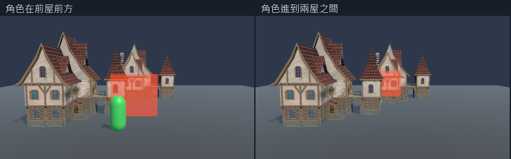
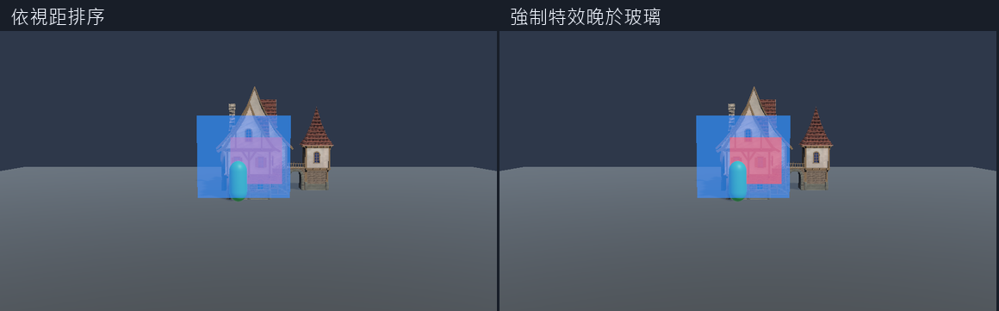

# HouseBenchmark 修訂報告

## 在 Unity 開始測試

1. 開啟 StormLab 的 `Assets/HouseBenchmark/HouseBenchmark.unity`。
2. 按 **Play**，從 **Game** 視窗左上角的面板切換案例。預設顯示 **A1、64 棟、4K**。
3. 逐一切換案例時，先固定房屋數量、Game 視窗解析度與貼圖大小，等畫面穩定，再看 **Stats** 的 Batches、SetPass 和 Tris。要核對實際繪製路徑，開啟 **Window → Analysis → Frame Debugger**，選擇目前的 Editor 目標並啟用。切換下一組前先關閉 Frame Debugger。

## 案例與比較方式

| 案例 | 畫面與操作 | 可以驗證什麼 |
| --- | --- | --- |
| A1 整棟 | House batches → A1 | 每棟一個 Mesh 的基準。 |
| A2 拆四件 | A1 → A2，維持 64 或 256 棟 | 同一棟拆成屋頂、牆體、木構、窗組的提交成本。 |
| A3 Static Batching | A2 → A3 | 一樣是四件，這次對靜態房屋在執行時合批。 |
| A4 Forward+ | A2 → A4 | 同一批拆件改用 Forward+ 的結果。 |
| A5 GPU Resident Drawer | A4 → A5 | 同用 Forward+，檢查 Resident Drawer 是否初始化。已啟用時可查 **HybridBatch**。 |
| A6 傳統 GPU Instancing | A2 → A6 | 相同的四組 Mesh 與共享材質開啟傳統實例化。A6 關閉 SRP Batcher，讓 SRP Batcher 相容的材質能走 instancing，請用 **Instanced Mesh** 核對。A2／A6 同時改變 SRP Batcher 狀態，因此不能把幀時間差全歸給 instancing。 |
| B1 Depth | 選 B1，來回拖角色深度 | 前後兩棟房屋共用 Static Batch。觀察角色標記與橘色半透明特效在前屋後方時被遮住，在兩屋之間時蓋住後屋。 |
| B2 Transparency | 選 B2，把角色／特效深度拖到正值，使橘色特效在藍玻璃後方，再切換 **Force FX after glass** | 強制橘色特效晚於玻璃混色時，兩者交疊顏色會變。角色本體仍參與深度測試。 |
| C Textures | 同一個視角切換 **2K textures**。可另切 **Close view** 比較近景和一般距離 | 瓦片、木紋與窗框在 2K 和 4K 的取樣細節。 |

### D City battle

在 Game 面板選 **D City battle**，會在房屋之間載入 CyberpunkCity 的 **Ember** 和 **Perlica**，連同原本的動作、放電和控制面板。

- 按 **C** 預覽蓄力、**F** 播放完整蓄力 → 放電 → 命中、**Space** 直接打測試目標、**R** 重置。左鍵可朝場景有碰撞體的位置射擊。
- **WASD** 移動鏡頭、**Q／E** 降低或升高、**右鍵拖曳**轉視角、**滾輪**縮放、**Home** 回到起始視角。其他互動案例也支援這組攝像機操作。
- 開啟上方 **Front house**，看前屋遮住的角色和特效。再切 **Glass**，看藍色透明片與電弧、波紋的交疊。這兩個開關使用視覺遮擋物，所以不會攔截 F／Space 的測試射線。
- **Back to benchmark** 返回 A1–A6 等案例。戰鬥案例沿用城市的渲染器，效能表仍是原來的純房屋量測。

**Game 面板用於即時預覽。** Stats 讀數會包含 Editor 與面板開銷。要在 Unity 另存一輪固定解析度量測，可先退出 Play，再選 **Tools → House Benchmark → Run All in This Project**。這一輪會在離屏目標測 A1–A6 × 64／256 棟，完成後退出 Play。每次輸出使用 `Builds/HouseBenchmarkResults` 下的時間戳資料夾。若普通 Play 的 A5 顯示 False，可到 **Project Settings → Graphics → Shader Stripping** 將 **BatchRendererGroup Variants** 設成 **Keep All**，或用上述完整量測選單，讓工具暫時套用 Keep All 並在離開 Play 後還原。

## 遮擋結果

B1 的兩棟屋子都回報為 Static Batch 成員。綠色膠囊和橘色透明片代表角色與世界特效。角色與前屋交疊的部分被深度測試遮住，橘色特效仍可顯示在後屋之前。

B2 固定角色和特效的位置。左圖按視距排序，右圖強制橘色特效最後繪製。藍玻璃和橘色效果的混色改變，這個差異來自透明佇列的次序。

## 2026-11-25 Unity Editor 實測

Unity 6000.3.15f1、URP、Windows、Direct3D 12、RTX 3060、i5-12400。離屏固定 1920 × 1080、4K 貼圖。每組暖機 180 幀，取 240 幀中位數。

| 組別 | 64 棟 Draw Calls | 256 棟 Draw Calls | 64／256 棟 SetPass | 64／256 棟幀時間中位數 |
| --- | ---: | ---: | ---: | ---: |
| A1 | 129 | 513 | 4／4 | 16.659／16.669 ms |
| A2 | 512 | 1942 | 5／10 | 16.665／16.67 ms |
| A3 | 56 | 177 | 5／10 | 16.668／14.422 ms |
| A4 | 512.5 | 1917 | 5／10 | 16.672／14.406 ms |
| A5 | 9 | 9 | 3／3 | 16.668／16.653 ms |
| A6 | 14 | 13 | 4／10 | 16.667／14.455 ms |

A5 的 grd_initialized 在 64／256 棟分別為 **True／True**。11/23 獨立執行檔的對照留在[原報告](../StormLab-House-Benchmark.md)。

幀時間是 Editor 此次環境的觀測值。不同組別提交的三角形數也會不同。比較合批時，先看 Draw Calls、SetPass 與 Frame Debugger 的事件類型。

- [量測 CSV](performance-editor-2026-11-25.csv)
- [貼圖和 mip 資料 CSV](textures-editor-2026-11-25.csv)
